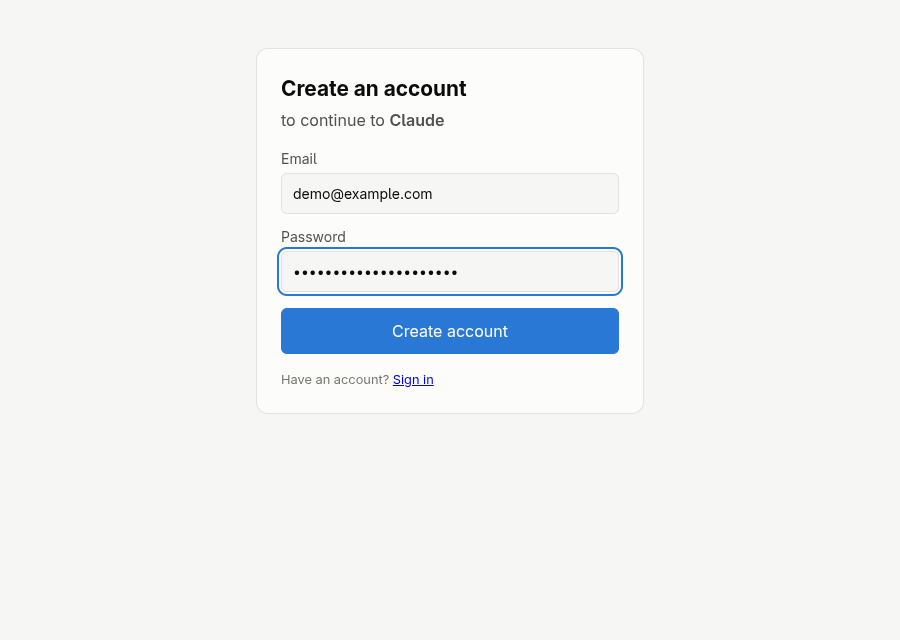
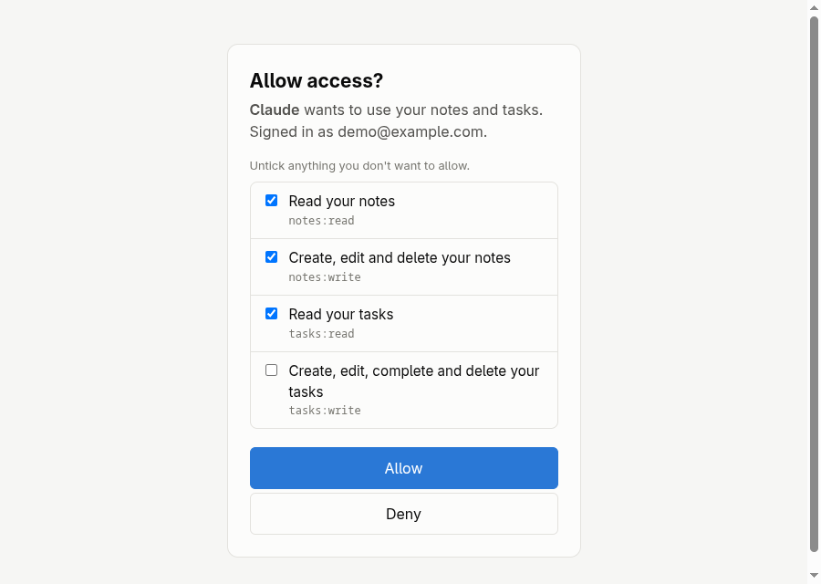
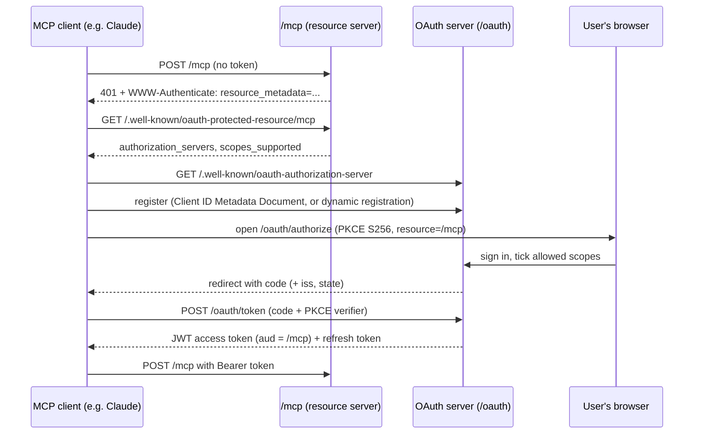

# Notes & Tasks MCP Server

[](https://github.com/haniyaiqbal/notes-tasks-mcp/actions/workflows/ci.yml)

An **MCP server** that gives AI assistants like Claude safe access to your personal notes and to-do list. You can say *"add a task to send the salary slips by Friday"* or *"what did I write about the bank loan?"*, and the assistant does it with your real data.

It follows the **current MCP specification (2026-07-28)**: tools, resources and prompts over **Streamable HTTP** and **stdio**, protected with **OAuth 2.1** exactly as the spec's authorization rules describe, with **scoped, deny-by-default permissions**.

Built with **NestJS 12, `@nestjs/mcp` (on the official MCP TypeScript SDK v2), `oidc-provider` and PostgreSQL**.

<p>
  
  
</p>

*When an AI app connects, the user signs in and chooses exactly what it may do. Here, "edit tasks" is unticked, so the app gets read-only access to tasks.*

## What the AI can do

### Tools

| Tool | What it does | Scope | Hints |
|---|---|---|---|
| `search_notes` | Full-text search by words and/or tag, returns previews | `notes:read` | read-only |
| `get_note` | One note with its full Markdown body | `notes:read` | read-only |
| `create_note` | New note with title, Markdown body, tags | `notes:write` | |
| `update_note` | Change fields, or `append_text` to add to the end | `notes:write` | destructive |
| `delete_note` | Delete a note (the AI is told to confirm first) | `notes:write` | destructive, idempotent |
| `list_tasks` | Filter by status, due date (overdue, today, next 7 days) and priority | `tasks:read` | read-only |
| `create_task` | New task with due date, priority, optional linked note | `tasks:write` | |
| `update_task` | Change fields, reopen | `tasks:write` | destructive, idempotent |
| `complete_task` | Mark done (safe to repeat) | `tasks:write` | idempotent |
| `delete_task` | Delete a task | `tasks:write` | destructive, idempotent |

Every tool has a **typed output schema** (`structuredContent`), so clients get real JSON back, not just text.

### Resources

| URI | What it is |
|---|---|
| `note://{id}` | One note as Markdown |
| `notes://pinned` | All pinned notes, as standing context |
| `tasks://open` | All open tasks as a Markdown checklist |

### Prompts

| Prompt | What it does |
|---|---|
| `daily_briefing` | Pulls in overdue, today's and upcoming tasks and asks for a plan for today |
| `weekly_review` | What got done this week, what's still open, recent notes, top 3 priorities |
| `summarize_notes` | Summarises notes (optionally by tag) and offers to turn action items into tasks |

## How connecting works

When you add this server to an MCP client, it finds out how to log in by itself. Nothing needs to be configured by hand:



## Design decisions

These are the choices worth talking about, and why I made them.

| Decision | Why |
|---|---|
| **The MCP endpoint is an OAuth "resource server"** | It only checks tokens: signature, issuer, **audience** (must be this server's `/mcp` URL, RFC 8707), expiry and type (`at+jwt`, so an ID token can't be used by mistake). It never looks inside the login server's database. That's how the MCP spec describes it, and how you would run it at scale. |
| **A real OAuth library instead of hand-written token code** | The SDK's built-in OAuth server is deprecated, and the spec recommends a dedicated one. `oidc-provider` is a certified OpenID Connect implementation, so the security-critical parts (PKCE, code exchange, refresh rotation) aren't home-made. |
| **PKCE S256 required for every client** | MCP clients are apps on the user's device. They can't keep a secret, so PKCE proves the app that started the login is the one finishing it. |
| **Both ways for a new client to register** | Client ID Metadata Documents (the client ID is an HTTPS URL describing the app, which the latest spec prefers) and Dynamic Client Registration (what older clients use). |
| **Scopes the user can untick** | The consent screen lists each permission. Unticked ones are recorded as declined, so the app gets a smaller token instead of being asked again. |
| **Deny by default, and write includes read** | Every tool, resource and prompt declares its scopes. A call without them gets **HTTP 403 `insufficient_scope`** naming the missing scope, before any code runs. The client can then ask the user for more (step-up). |
| **Every query is filtered by the user** | The user ID comes from the verified token, and every database query includes it. Another user's note simply doesn't exist: there's no "403 forbidden" that would hint it does. |
| **Stateless HTTP (protocol 2026-07-28)** | No sessions to store, so it runs behind any load balancer. Older (2025) clients are still served, statelessly. |
| **Host header checks** | Protects against DNS-rebinding attacks on servers running on localhost, as the spec requires. |
| **Refresh tokens rotate** | Each refresh gives a new refresh token. Reusing an old one fails, so a stolen refresh token stops working. |
| **The OAuth server's data is in Postgres** | Codes, grants, sessions and refresh tokens survive restarts and work across several instances. Using a code twice is blocked atomically, even if two requests race. |
| **Tools are written for the AI** | Clear descriptions, behaviour hints (`readOnlyHint`, `destructiveHint`, `idempotentHint`), server instructions ("search before creating", "confirm before deleting"), and short previews in search results, with `get_note` for the full text, to save the model's context. |
| **The login pages are plain HTML** | Server-rendered forms that work without JavaScript. Every value is escaped, the forms are tied to a cookie (so another site can't submit them), and sign-in is rate-limited. |
| **Passwords use scrypt** | With OWASP's recommended settings and a random salt. Unknown emails still go through a full hash check, so response times don't reveal which accounts exist. |

## Spec checklist

| MCP authorization requirement | Where |
|---|---|
| Protected Resource Metadata (RFC 9728) | `/.well-known/oauth-protected-resource/mcp` |
| 401 with `WWW-Authenticate: Bearer resource_metadata=...` | every unauthenticated `/mcp` request |
| Authorization Server Metadata (RFC 8414) | `/.well-known/oauth-authorization-server` |
| PKCE with S256 | required for all clients; only S256 accepted |
| Resource indicators (RFC 8707) and audience checks | tokens are issued for `/mcp` and refused elsewhere |
| `iss` in the authorization response (RFC 9207) | yes |
| Client ID Metadata Documents / Dynamic Client Registration | both |
| 403 `insufficient_scope` with the needed `scope` | per tool, resource and prompt |
| Tokens never in the URL | header only (`bearer_methods_supported: ["header"]`) |
| stdio takes credentials from the environment | `STDIO_USER_EMAIL` |

## Run it

```bash
npm install
npm run keys:generate        # prints OAUTH_SIGNING_KEY and COOKIE_SECRET
cp .env.example .env         # then paste those two lines into .env

docker compose up -d postgres
npm run start:dev            # MCP: http://localhost:3000/mcp
```

Or everything in Docker (after putting the keys in `.env`):

```bash
docker compose up --build
```

### Connect it to Claude Code

```bash
claude mcp add --transport http notes-tasks http://localhost:3000/mcp
```

Then run `/mcp` in Claude Code and choose **Authenticate**. A browser opens to sign up and pick permissions.

### Try it with the MCP Inspector

```bash
npm run inspector            # then connect to http://localhost:3000/mcp
```

### Use it over stdio (Claude Desktop and others)

Create an account first (by connecting once over HTTP), then add this to your client's MCP config:

```json
{
  "mcpServers": {
    "notes-tasks": {
      "command": "node",
      "args": ["--env-file=/path/to/notes-tasks-mcp/.env", "/path/to/notes-tasks-mcp/dist/stdio.js"],
      "env": { "STDIO_USER_EMAIL": "you@example.com" }
    }
  }
}
```

Over stdio there is no OAuth: the MCP spec says local servers take credentials from the environment. The process acts as that one user.

## Tests

```bash
npm test            # unit tests
npm run test:e2e    # end-to-end tests (needs: docker compose up -d postgres)
```

The end-to-end tests run the real server over HTTP and go through the **whole OAuth flow** the way an MCP client would: discovery, registration, the real sign-up and consent forms (with cookies), code exchange, refresh. Then they call the tools with the token. They cover:

- Discovery metadata, and 401 without a token
- The full login flow, including the `iss` and `state` checks
- A reused authorization code, a wrong PKCE verifier, and a reused refresh token are all refused
- Denying consent sends the user back with `access_denied`; a wrong password stays on the login page
- Tokens for another audience, expired tokens, and forged tokens are refused
- Every tool, resource and prompt works, and input is validated
- One user can't read, find or delete another user's notes
- Unticked scopes are really missing from the token, and calls that need them get **403 `insufficient_scope`** with the right challenge
- `write` scopes include `read`

The unit tests cover the token checker, scope rules, password hashing and HTML escaping.

## Project structure

```
src/
  mcp/        MCP server setup, token verifier, scopes, prompts
  notes/      notes: service (business logic) and MCP tools/resources
  tasks/      tasks: service and MCP tools/resources
  oauth/      OAuth server (oidc-provider), Postgres adapter, login/consent pages
  users/      accounts and password hashing
  database/   data source and migrations
  main.ts     HTTP entry point
  stdio.ts    stdio entry point
scripts/      key generation
test/         end-to-end tests and the test OAuth client
```

## License

MIT
